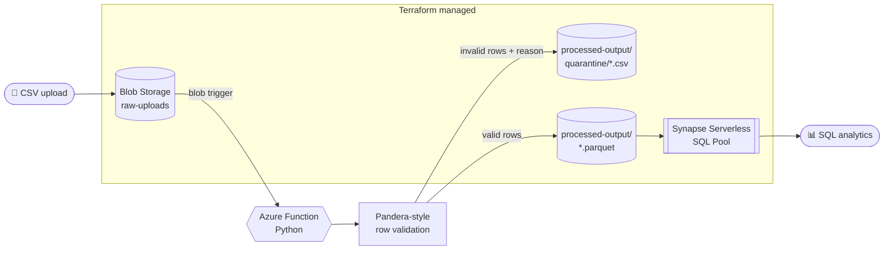

<div align="center">

# ☁️ StratoFlow

### Serverless data refinery on Azure

**Upload a messy CSV. Get validated, quarantined, query-ready Parquet, automatically.**

[](https://github.com/SlazzInC0de/stratoflow/actions/workflows/deploy.yml)


</div>

---

## ✨ Highlights

| | |
|---|---|
| ⚡ **Event-driven** | A blob upload triggers the pipeline. No servers, no schedulers. |
| 🛡️ **Row-level validation** | Sensor-aware rules quarantine bad rows with a reason code instead of failing the whole batch. |
| 📦 **61.7% smaller output** | Clean data lands as columnar Parquet (28.5 KB CSV → 10.9 KB). |
| 🔎 **Instantly queryable** | Synapse Serverless SQL reads the Parquet in place via `OPENROWSET`. |
| 🏗️ **100% IaC** | Storage, containers, Synapse, firewall and RBAC are all in Terraform. |
| ✅ **Tested + CI** | Pytest suite, flake8 and `terraform validate` on every push. |

## 🏛️ Architecture



## 🛡️ Validation and quarantine

Every row is checked independently, and failures are routed to quarantine with the reason attached, mirroring a production dead-letter pattern. Ranges are **sensor-type aware**: temperature, humidity, pressure and battery each have their own bounds.

Result on the bundled 500-row dataset with deliberately injected noise:

| Outcome | Rows |
|---|---:|
| ✅ Valid | **450** |
| Missing `reading_value` | 18 |
| Missing `device_id` | 15 |
| Out-of-range reading (sensor glitch) | 9 |
| Invalid dtype (`"ERROR"` string) | 8 |

## 📦 Why Parquet

| Format | Size |
|---|---:|
| CSV | 28,494 bytes |
| Parquet | 10,910 bytes |
| **Saving** | **61.7%** |

Columnar storage plus compression, and Synapse queries it directly with no load step.

## 🔎 Analytics layer

```sql
SELECT sensor_type, AVG(reading_value) AS avg_reading, COUNT(*) AS readings
FROM OPENROWSET(
    BULK 'https://stratoflowdata.blob.core.windows.net/processed-output/valid_rows.parquet',
    FORMAT = 'PARQUET'
) AS rows
GROUP BY sensor_type;
```

More queries live in [`sql/analytics_queries.sql`](sql/analytics_queries.sql).

## 🧰 Tech stack

| Layer | Tool |
|---|---|
| Storage | Azure Blob Storage |
| Compute | Azure Functions (Python, blob trigger) |
| Validation | pandas + Pandera schema |
| Format | Parquet (PyArrow) |
| Analytics | Azure Synapse Serverless SQL |
| IaC | Terraform (`azurerm`) |
| CI | GitHub Actions |
| Tests | Pytest |

## 🚀 Run it locally

```bash
git clone https://github.com/SlazzInC0de/stratoflow.git
cd stratoflow
python -m venv .venv && source .venv/bin/activate   # Windows: .venv\Scripts\activate
pip install -r requirements.txt pytest

# Phase 1 pipeline on the sample data
python scripts/generate_sample_data.py     # optional: regenerate raw data
python scripts/split_valid_invalid.py      # -> data/valid_rows.csv + data/quarantined_rows.csv
python scripts/convert_to_parquet.py       # -> data/valid_rows.parquet (+ size report)

pytest -v
```

**Deploy the infrastructure**

```bash
cd terraform
terraform init
terraform plan
terraform apply
```

The Function reads its storage connection from `AzureWebJobsStorage` and writes to the `processed-output` container (override with `OUTPUT_CONTAINER`).

## 🔁 CI/CD

GitHub Actions runs on every push and PR:

- **Test & Lint**: Pytest suite and flake8
- **Terraform Validate & Format**: `fmt -check` and `validate` without cloud credentials

`terraform apply` is run manually. The institutional Azure tenant blocks service principal creation, which GitHub Actions normally needs to authenticate. In an unrestricted tenant this would move to OIDC federated credentials.

## 💸 Cost

Consumption-tier Functions (1M free executions/month), Blob Storage and pay-per-query Synapse keep **1,000 runs/month under $1**.

## 🗺️ Roadmap

- [ ] Partition Parquet by date and `sensor_type`
- [ ] Schema evolution for new sensor types
- [ ] Service Bus dead-letter queue with alerting
- [ ] Dashboard on top of the Synapse views
- [ ] OIDC-based `terraform apply` in CI

## 📁 Project structure

```text
stratoflow/
├── function_app.py        # Azure Function: blob trigger -> validate -> Parquet
├── schemas/               # Validation schema and sensor ranges
├── scripts/               # Data generation, split, Parquet conversion
├── tests/                 # Pytest suite
├── sql/                   # Synapse analytics queries
├── terraform/             # IaC: storage, Synapse, IAM
├── data/                  # Sample dataset and outputs
└── .github/workflows/     # CI pipeline
```

## 📄 License

MIT © [Suryansh Verma](https://github.com/SlazzInC0de)
